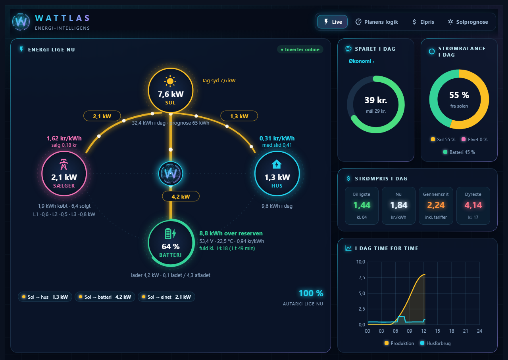
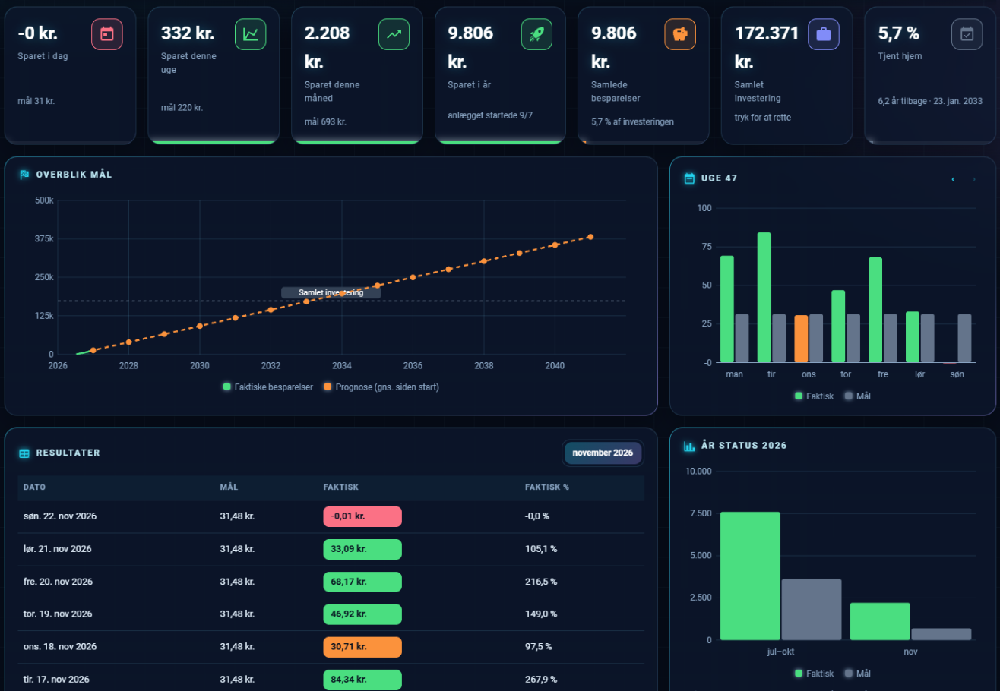
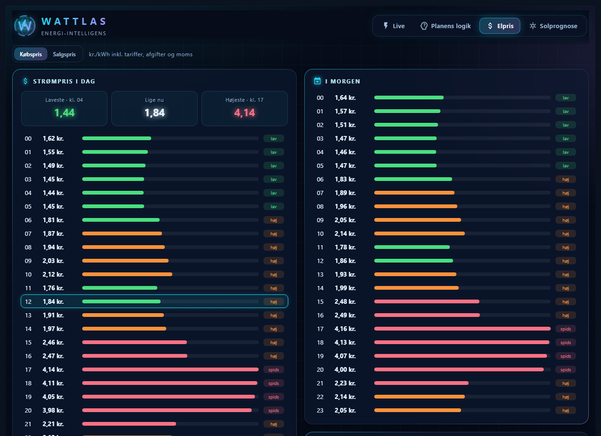
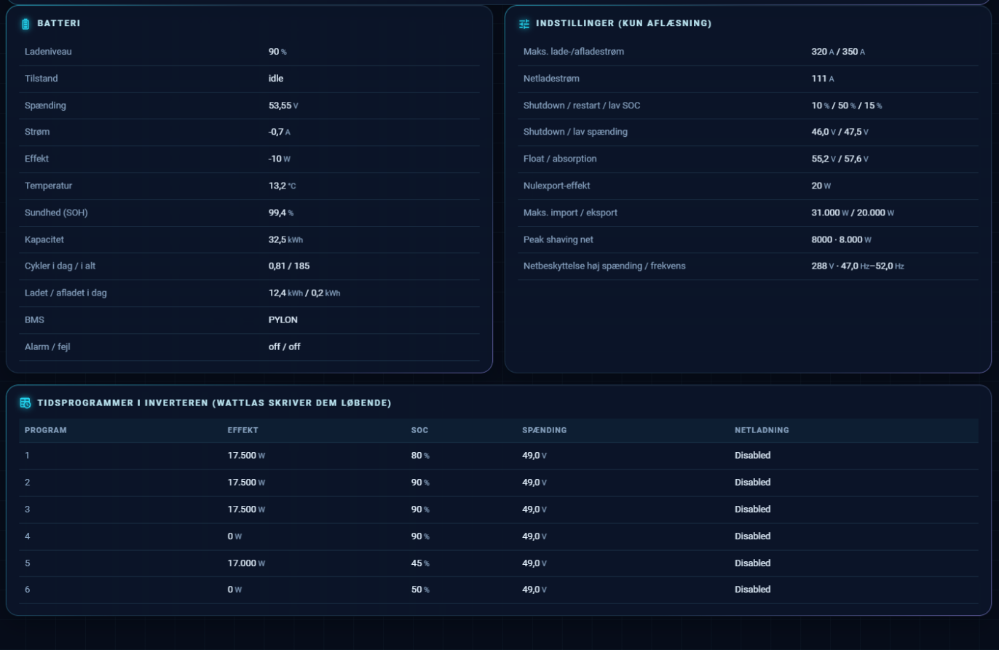

# Wattlas

**Batteri- og solcellestyring til Home Assistant – med EMHASS som hjerne og en app som ansigt.**

> ⚠️ **ALPHA.** Wattlas styrer din inverter og dit batteri. Læs [SIKKERHED.md](docs/SIKKERHED.md), før du slår styringen til.
> Du bruger det på eget ansvar.
>
> Wattlas er under aktiv udvikling og opdateres løbende. Se [CHANGELOG.md](CHANGELOG.md) for, hvad der er nyt.

Wattlas lader [EMHASS](https://emhass.readthedocs.io/) lægge en plan for de næste 24–48 timer. Planen bygger på spotpriser,
nettarif, solprognose og husets forbrug. Wattlas følger planen hvert 30. sekund og skriver kun til inverteren, når noget skal ændres.
Hårde grænser for sikringer, batteri og fase-strøm gælder altid, uanset hvad planen siger.

## Hvad får du

| | |
|---|---|
| **Styring** | EMHASS-plan (MPC) hvert 5. min., netladning i de billige timer, batteri til de dyre, solsalg kun ved positiv salgspris, ugentlig fuldladning (LiFePO4-balancering) |
| **Sikkerhed** | Startspærre til alt er indstillet, fasegrænse pr. fase, importloft, plan-validering, reserveplan hvis EMHASS forsvinder, automatisk selvforbrug ved fejl, besked ved udfald |
| **Tilsidesættelser** | Lad nu / ingen netladning / gem batteriet / brug batteriet / stop solsalg – altid med udløb |
| **Regler** | Tidsstyrede regler (fx "hverdage 16–21: gem batteriet til 80 %"), med arbejdsdage via Workday |
| **Hvad-hvis** | Beregn planen med andre indstillinger uden at røre den rigtige styring |
| **Fleksibel forbruger** | Lad EMHASS lægge varmtvandsbeholder, elbil eller pool i de bedste timer via en kontakt i HA |
| **App** | To dashboards: *Wattlas* (live-energiflow, økonomi, historik, elpris, solprognose) og *Wattlas Styring* (styring, regler, planens logik, overvågning, teknik) |
| **Økonomi** | Sparet i dag/uge/måned/i alt, tilbagebetalingstid, rekorder, ugerapport søndag aften |

## Sådan ser det ud

### Wattlas – appen

| Økonomi: sparet pr. dag, uge og år og tilbagebetalingstid | Historik: produktion, forbrug, salg og batteri |
|---|---|
|  |  |

| Elpris time for time, inkl. tariffer | Solprognose mod målt produktion |
|---|---|
|  |  |

### Wattlas Styring

**Styring:** status, elpris og manuel tilsidesættelse. Vælg varighed (30 min, 1, 2 eller 4 timer eller til midnat) og
ladeniveau (60, 80 eller 100 %), og tryk *Lad nu*, *Ingen netopladning*, *Gem batteriet*, *Brug batteriet* eller *Stop solsalg*.
Tilsidesættelsen udløber altid af sig selv.

**Avancerede indstillinger:** reserve, slut-niveau, net-loft, batterislid, ugentlig fuldladning, *hvad-hvis*-beregning
og fleksibel forbruger.

| Regler: faste tidsrum, fx "hverdage 16–21: gem batteriet" | Overvågning: advarsler, forbindelser og beskeder |
|---|---|
|  |  |

**Planens logik:** hvad EMHASS har planlagt, hvorfor, og 7 automatiske tjek.

| Teknik: strenge (PV), spænding, strøm og effekt pr. fase | Teknik: batteri, inverterens indstillinger og tidsprogrammer |
|---|---|
|  |  |

*Live, planens logik, elpris og solprognose er vist med opdigtede demotal. De øvrige billeder er fra en rigtig installation.*

## Hvilke invertere

Wattlas taler med inverteren gennem en **styrekanal**, en fil med adapter-entiteter. Kernen er den samme for alle.

| Styrekanal | Status |
|---|---|
| `styrekanaler/deye_solarman` – Deye (3-faset, lavvolt-batteri) via [ha-solarman](https://github.com/davidrapan/ha-solarman) | styrelogikken kører dagligt hos udvikleren; selve udgivelsesversionen (indstillinger, startspærre) er valideret med HA's config-check, men ikke kørt i drift endnu |
| `styrekanaler/sunmate` – SunMate.IO pulse styrer inverteren | **ikke testet** med denne version |
| Sunsynk / Sol-Ark / andre Deye-kloner | brug Deye-kanalen, hvis dine entiteter hedder det samme; ellers skriv din egen ([STYREKANALER.md](docs/STYREKANALER.md)) |

Begrænsninger i alpha: kun 48 V-batterier (spændingsvindue 45–58 V), 3-faset net, dansk nettarif med tre tidsperioden
(0–6, 6–17/21–24, 17–21), spotpris fra Energi Data Service og solprognose i kvarterstal (Helios Forecast anbefales).

## Kom i gang

1. **[docs/BILLEDGUIDE.md](docs/BILLEDGUIDE.md) – installationen trin for trin med billeder.**
   Uddybning og manuel installation: [docs/INSTALLATION.md](docs/INSTALLATION.md) – installér *Wattlas* fra Markedspladsen, og tilføj integrationen.
   Opsætningen tjekker, om du mangler noget, viser vej til det, spørger om dine tal og lægger det hele på plads.
   Ingen kommandoer. (`install.sh` og manuel installation findes til avancerede brugere.)
2. [docs/KONFIGURATION.md](docs/KONFIGURATION.md) – hvad hvert tal betyder, og hvordan du finder dit.
3. [docs/BRUG.md](docs/BRUG.md) – sådan bruger du styringen: tilsidesættelser, indstillinger, hvad-hvis, fleksibel
   forbruger, regler og planens logik.
4. [docs/SOLPROGNOSE.md](docs/SOLPROGNOSE.md) – hvorfor Helios Forecast, og hvad en anden prognose skal kunne.
5. [docs/FAQ.md](docs/FAQ.md)

## Licens

MIT – se [LICENSE](LICENSE). Wattlas er ikke tilknyttet Deye, SunMate, EMHASS eller Home Assistant.
