# Wattlas

**Åben styring af solceller og batteri i Home Assistant.**

Wattlas lader batteriet op, når strømmen er billig, og bruger det, når den er dyr. Den passer på dine sikringer imens,
viser hvorfor den gør, som den gør, og kan arbejde sammen med resten af huset: varmepumpe, varmt vand, ladestander og
hvidevarer. Alt kører lokalt hos dig selv, og koden er åben.

> ⚠️ **ALPHA.** Wattlas styrer din inverter og dit batteri. Læs [SIKKERHED.md](docs/SIKKERHED.md), før du slår styringen til.
> Du bruger det på eget ansvar.
>
> Wattlas er under aktiv udvikling og opdateres løbende. Se [CHANGELOG.md](CHANGELOG.md) for, hvad der er nyt.

Wattlas lader [EMHASS](https://emhass.readthedocs.io/) lægge en plan for de næste 24–48 timer. Planen bygger på spotpriser,
nettarif, solprognose og husets forbrug. Wattlas følger planen hvert 30. sekund og skriver kun til inverteren, når noget skal ændres.
Hårde grænser for sikringer, batteri og fase-strøm gælder altid, uanset hvad planen siger.

## Hvorfor Wattlas

Mange anlæg kommer med en færdig AI-styring fra leverandøren. Wattlas blev til, fordi den slags styring faldt ud for tit,
tog beslutninger, man ikke kunne få forklaret, og ikke kunne arbejde sammen med resten af huset.

| | Færdig AI-styring fra leverandøren | Wattlas |
|---|---|---|
| **Hvor den kører** | Typisk i leverandørens sky. Falder forbindelsen ud, står styringen | Lokalt i dit eget Home Assistant |
| **Når noget går galt** | Du opdager det ofte først bagefter | Skifter selv til selvforbrug, sender besked og genoptager |
| **Hvorfor gør den sådan?** | Sjældent en forklaring | Hver beslutning vises med priser og regnestykke, plus 7 automatiske tjek |
| **Sikringerne** | Lader ofte uden at se på, hvad huset bruger imens | Grænse pr. fase og samlet loft, som du selv sætter |
| **Resten af huset** | Kun det udstyr, leverandøren har valgt | Alt, Home Assistant kender, kan kobles på: varmepumper, termostater, ladestander, hvidevarer |
| **Din kontrol** | Få indstillinger | Tilsidesættelser med ét tryk, faste regler og hvad-hvis-beregning |
| **Dine data** | Typisk hos leverandøren | Bliver i dit hus |
| **Koden** | Lukket | Open source – du kan se og ændre alt |
| **Nye ønsker** | Du venter på leverandøren | Opret et issue – gode forslag bygges ind |

I udviklerens eget hus sparede Wattlas 15–22 kr. om dagen efter slid i en efterårsmåned, sammenlignet med den
almindelige selvforbrugs-styring, inverteren selv kan. Hele historien, tallene bag og hvad der er indbygget i dag, står i
**[docs/OM_WATTLAS.md](docs/OM_WATTLAS.md)**.

Wattlas er open source. Idéer og ønsker er meget velkomne – opret et issue, så bygger vi de gode forslag ind.

## Hvad får du

| | |
|---|---|
| **Styring** | EMHASS-plan (MPC) hvert 5. min., netladning i de billige timer, batteri til de dyre, solsalg kun ved positiv salgspris, ugentlig fuldladning (LiFePO4-balancering) |
| **Sikkerhed** | Startspærre til alt er indstillet, fasegrænse pr. fase, importloft, plan-validering, reserveplan hvis EMHASS forsvinder, automatisk selvforbrug ved fejl, besked ved udfald |
| **Tilsidesættelser** | Lad nu / ingen netladning / gem batteriet / brug batteriet / stop solsalg – altid med udløb |
| **Regler** | Tidsstyrede regler (fx "hverdage 16–21: gem batteriet til 80 %"), med arbejdsdage via Workday |
| **Hvad-hvis** | Beregn planen med andre indstillinger uden at røre den rigtige styring |
| **Fleksibel forbruger** | Lad EMHASS lægge varmtvandsbeholder, elbil eller pool i de bedste timer via en kontakt i HA |
| **App** | To dashboards: *Wattlas* (live-energiflow, økonomi, historik, elpris, solprognose) og *Wattlas Styring* (styring, regler, planens logik, overvågning, teknik) |
| **Økonomi** | Sparet i dag/uge/måned/i alt, tilbagebetalingstid, rekorder, ugerapport søndag aften |

## Sådan ser det ud

### Wattlas – appen

| Økonomi: sparet pr. dag, uge og år og tilbagebetalingstid | Historik: produktion, forbrug, salg og batteri |
|---|---|
|  | 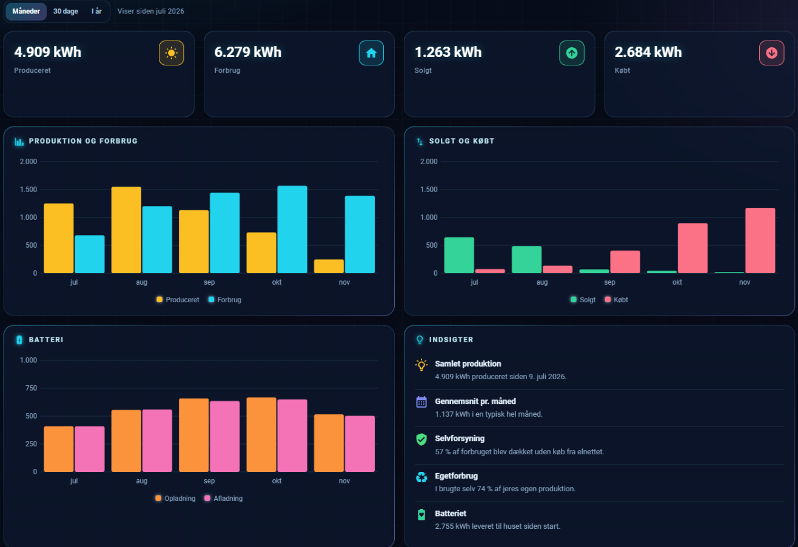 |

| Elpris time for time, inkl. tariffer | Solprognose mod målt produktion |
|---|---|
|  | 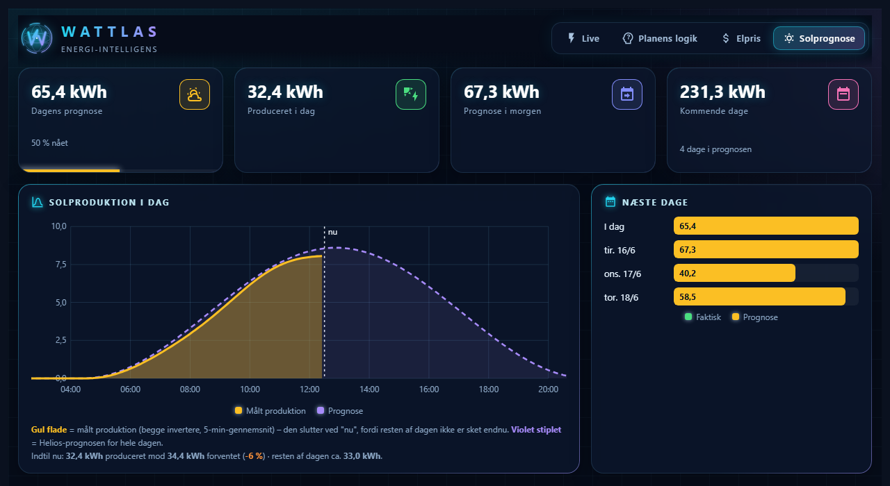 |

### Wattlas Styring

**Styring:** status, elpris og manuel tilsidesættelse. Vælg varighed (30 min, 1, 2 eller 4 timer eller til midnat) og
ladeniveau (60, 80 eller 100 %), og tryk *Lad nu*, *Ingen netopladning*, *Gem batteriet*, *Brug batteriet* eller *Stop solsalg*.
Tilsidesættelsen udløber altid af sig selv.

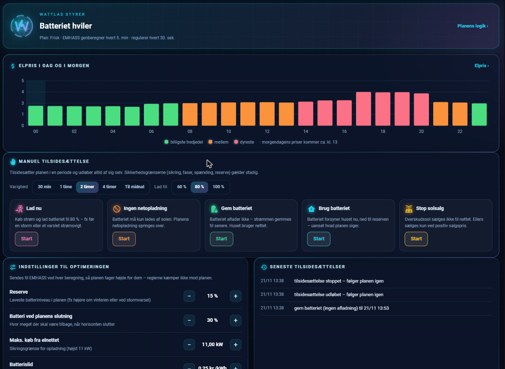

**Avancerede indstillinger:** reserve, slut-niveau, net-loft, batterislid, ugentlig fuldladning, *hvad-hvis*-beregning
og fleksibel forbruger.

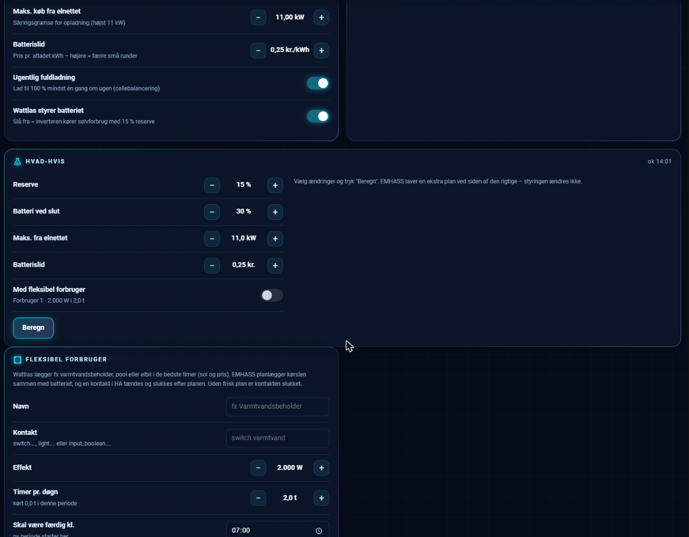

| Regler: faste tidsrum, fx "hverdage 16–21: gem batteriet" | Overvågning: advarsler, forbindelser og beskeder |
|---|---|
| 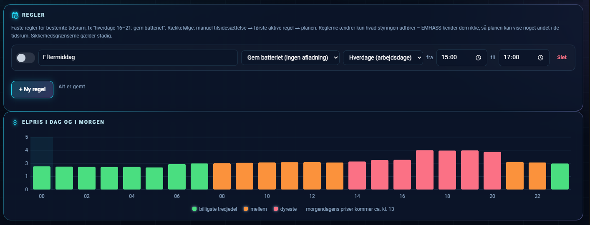 | 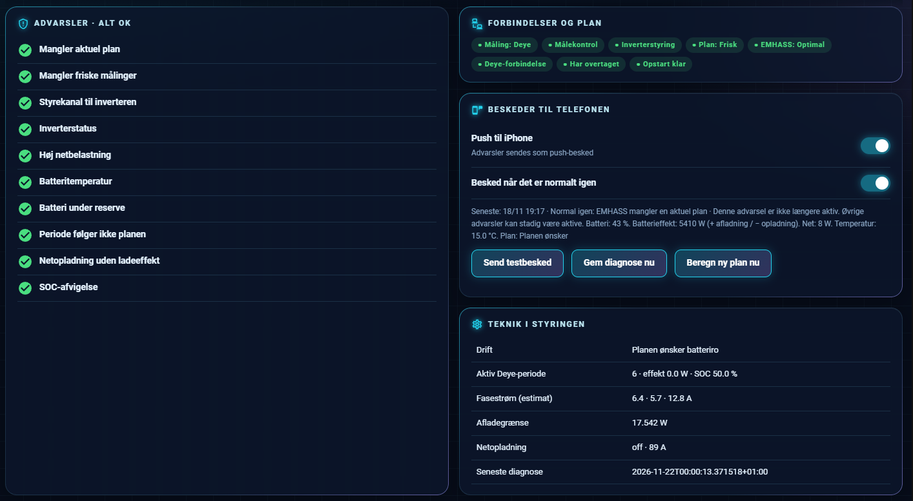 |

**Planens logik:** hvad EMHASS har planlagt, hvorfor, og 7 automatiske tjek.

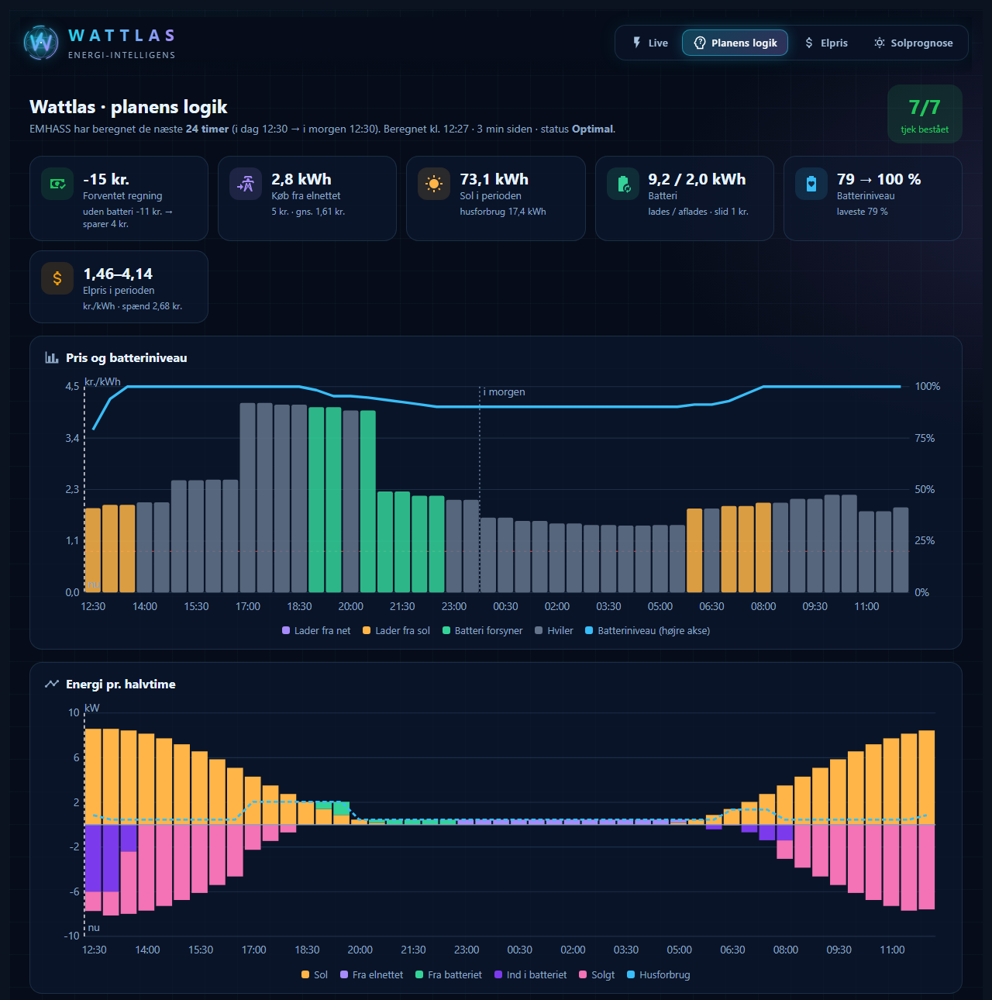

| Teknik: strenge (PV), spænding, strøm og effekt pr. fase | Teknik: batteri, inverterens indstillinger og tidsprogrammer |
|---|---|
| 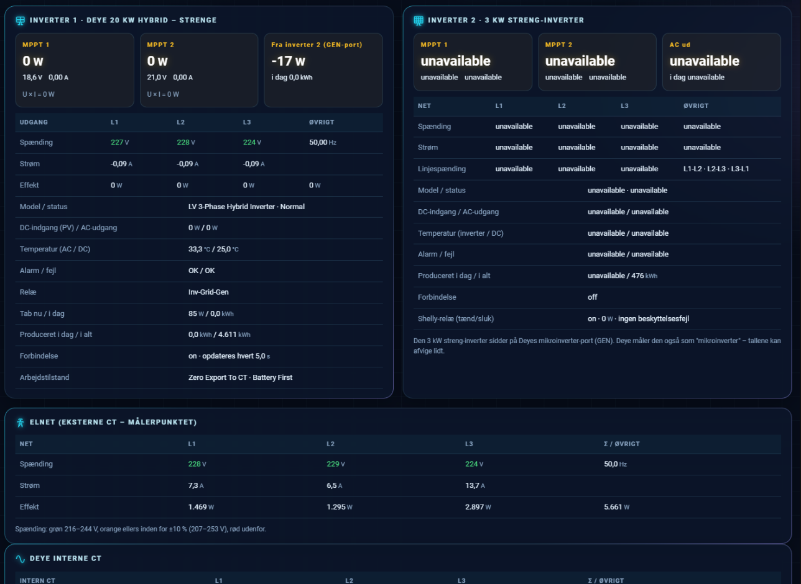 |  |

### På telefonen

| Live | Økonomi | Styring | Planens logik |
|---|---|---|---|
| 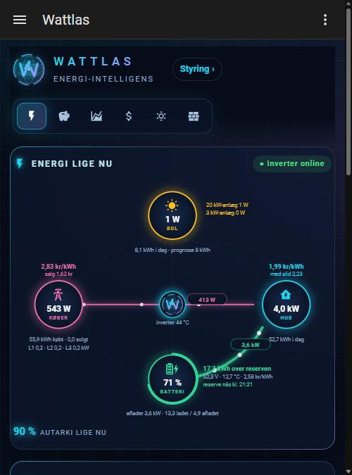 | 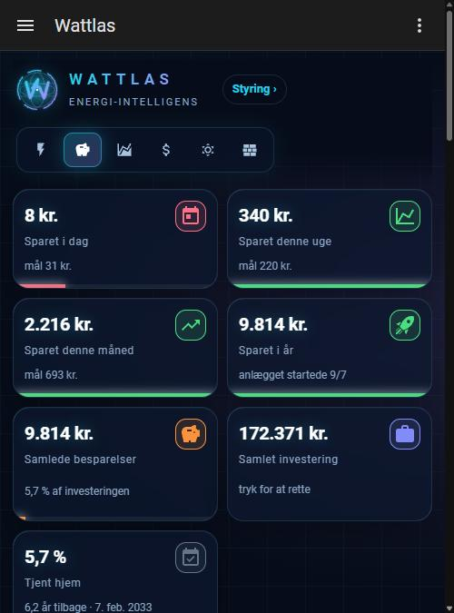 | 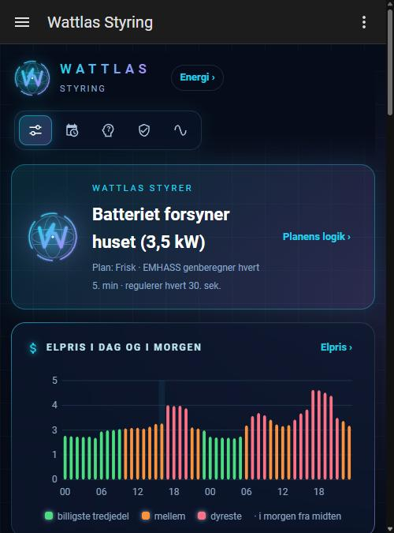 | 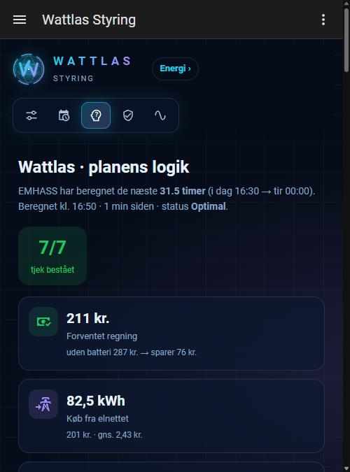 |

*Live, planens logik, elpris og solprognose i de store billeder er vist med opdigtede demotal. De øvrige billeder, også dem fra telefonen, er fra en rigtig installation.*

## Hvilke invertere

Wattlas taler med inverteren gennem en **styrekanal**, en fil med adapter-entiteter. Kernen er den samme for alle.

| Styrekanal | Status |
|---|---|
| `styrekanaler/deye_solarman` – Deye (3-faset, lavvolt-batteri) via [ha-solarman](https://github.com/davidrapan/ha-solarman) | styrelogikken kører dagligt hos udvikleren; selve udgivelsesversionen (indstillinger, startspærre) er valideret med HA's config-check, men ikke kørt i drift endnu |
| `styrekanaler/sunmate` – SunMate.IO pulse styrer inverteren | **ikke testet** med denne version |
| `styrekanaler/huawei` (+ `huawei_emma`) – Huawei SUN2000 + LUNA2000 med Huawei-elmåler eller EMMA via [Huawei Solar](https://github.com/wlcrs/huawei_solar) | testet mod en simuleret Huawei, **ikke kørt i drift endnu**; EMMA-udgaven er eksperimentel – se [STYREKANALER.md](docs/STYREKANALER.md) |
| Sunsynk / Sol-Ark / andre Deye-kloner | brug Deye-kanalen, hvis dine entiteter hedder det samme; ellers skriv din egen ([STYREKANALER.md](docs/STYREKANALER.md)) |

Vi har kun en Deye at teste på. Har du en anden inverter, hjælper vi gerne med at bygge og teste en direkte kobling
sammen med dig – opret et issue og fortæl, hvilken inverter du har.

Begrænsninger i alpha: kun 48 V-batterier (spændingsvindue 45–58 V; Huawei-kanalen omregner sit højvoltbatteri), 3-faset net, dansk nettarif med tre tidsperioden
(0–6, 6–17/21–24, 17–21), spotpris fra Energi Data Service og solprognose i kvarterstal (Helios Forecast anbefales).

## Kom i gang

1. **[docs/BILLEDGUIDE.md](docs/BILLEDGUIDE.md) – installationen trin for trin med billeder.**
   Uddybning og manuel installation: [docs/INSTALLATION.md](docs/INSTALLATION.md) – installér *Wattlas* fra Markedspladsen, og tilføj integrationen.
   Opsætningen tjekker, om du mangler noget, viser vej til det, spørger om dine tal og lægger det hele på plads.
   Ingen kommandoer. (Uden Markedspladsen kan `install.sh` lægge integrationen ind; helt manuel installation findes også.)
2. [docs/KONFIGURATION.md](docs/KONFIGURATION.md) – hvad hvert tal betyder, og hvordan du finder dit.
3. [docs/BRUG.md](docs/BRUG.md) – sådan bruger du styringen: tilsidesættelser, indstillinger, hvad-hvis, fleksibel
   forbruger, regler og planens logik.
4. [docs/OM_WATTLAS.md](docs/OM_WATTLAS.md) – hvorfor Wattlas findes, sammenligning med en færdig AI-styring og et eksempel fra et rigtigt hus.
5. [docs/SOLPROGNOSE.md](docs/SOLPROGNOSE.md) – hvorfor Helios Forecast, og hvad en anden prognose skal kunne.
6. [docs/FAQ.md](docs/FAQ.md)

## Udvikling

`packages/`, `styrekanaler/`, `dist/`, `dashboards/` og `custom_components/wattlas/payload/` er genereret fra udviklerens
egen installation. Ret ikke direkte i dem i en pull request – beskriv ændringen i en issue. Integrationens egen kode
(`custom_components/wattlas/*.py`) har tests i `tests/`. De kræver `pip install homeassistant` og køres enkeltvis, fx
`python tests/test_installer.py`.

## Licens

MIT – se [LICENSE](LICENSE). Wattlas er ikke tilknyttet Deye, Huawei, SunMate, EMHASS eller Home Assistant.
