# Installation – billedguide

Sådan installerer du Wattlas, trin for trin. Billederne er taget på en helt ny Home Assistant (2026.11) med en
**simuleret** inverter, så tallene på billederne er testtal. Hele forløbet tager ca. 15 minutter, når forudsætningerne
er på plads.

> Kort fortalt: installér Wattlas fra Markedspladsen → *Tilføj integration → Wattlas* → udfyld skærmene →
> tryk *Genstart* under Reparationer. Wattlas fortæller selv, hvis du mangler noget.

---

## Før du starter

Wattlas bygger på nogle andre dele. Du behøver ikke vide på forhånd, om du har dem – Wattlas tjekker det i trin 4 og
viser en knap til det, der mangler. Men har du dem klar, går det hurtigere:

| Hvad | Hvorfor | Hvor |
|---|---|---|
| **EMHASS-app'en** | regner planen ud | Indstillinger → Apps → tilføj `https://github.com/davidusb-geek/emhass-add-on` → EMHASS → Installér → Start |
| **Energi Data Service** | spotpriser | Markedsplads → Energi Data Service. Vælg Danmark, dit prisområde og *priser med moms* |
| **Workday** | arbejdsdage og helligdage | Indstillinger → Enheder og tjenester → Tilføj integration → Workday → Danmark |
| **Helios Forecast** | solprognose | Markedsplads → Helios Forecast. Opsæt dit anlæg (hældning, retning, kWp) |
| **Din inverters integration** | læse og styre inverteren | Deye: *Solarman* fra Markedspladsen. SunMate: SunMate-integrationen |
| En **vejr-entitet** | temperatur i husprognosen | Met.no følger med Home Assistant |

### EMHASS-nøglen

EMHASS kræver en API-nøgle, som **du selv vælger**. Åbn EMHASS-app'en → fanen **Konfiguration** → slå *Vis ubrugte
valgfrie konfigurationsmuligheder* til. Skriv en kode på mindst 8 tegn i **emhass_api_token**, tryk **Gem** og
genstart app'en. Skriv koden ned – du skal bruge den i trin 5.

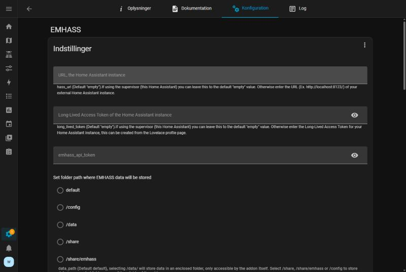

---

## 1. Installér Wattlas fra Markedspladsen

Indstillinger → **Markedsplads** → søg *Wattlas* → **Installér**. Genstart Home Assistant bagefter.

> Wattlas ligger endnu ikke i Markedspladsens katalog. Indtil da: Markedsplads → ⋮ → **Tilføj fra link** →
> `https://github.com/Vuzeoc/wattlas`, type *Integration*. (Kræver at du har koblet en GitHub-konto til Markedspladsen.)

## 2. Tilføj integrationen

Indstillinger → **Enheder og tjenester** → **Tilføj integration** (knappen nederst til højre).

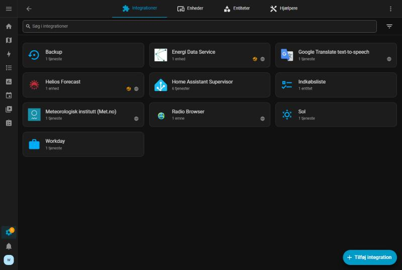

Skriv **Wattlas** i søgefeltet, og vælg den.

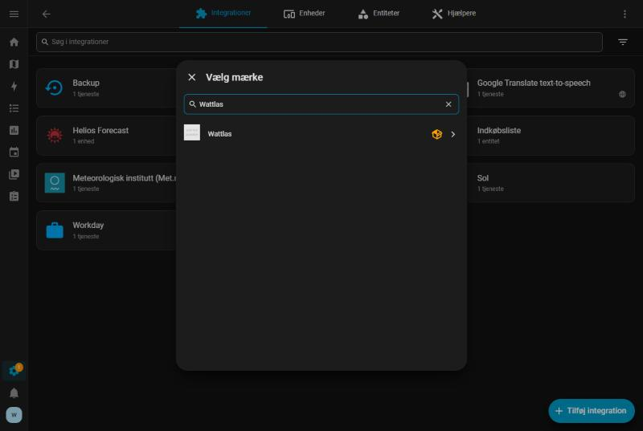

## 3. Vælg inverter-type og din inverter

Vælg, hvordan Home Assistant taler med din inverter: **Deye (via Solarman)** eller **SunMate**. Tryk *Indsend*.

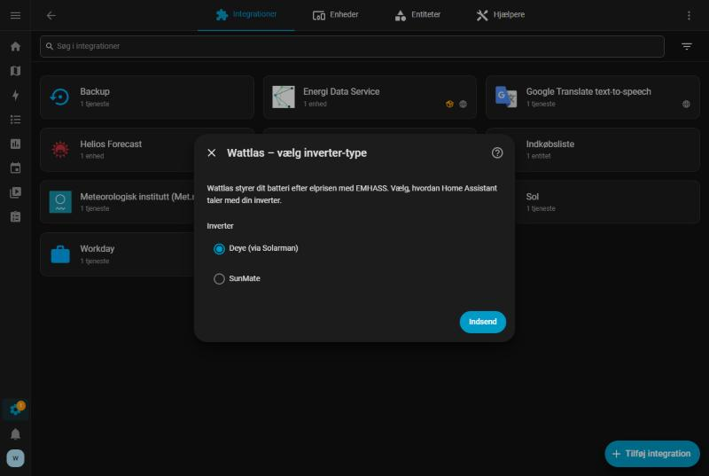

Vælg din inverters **solcelle-effekt** på listen – for Deye er det entiteten, der slutter på `_pv_power`. Wattlas
finder selv resten af inverterens entiteter ud fra den.

De fleste har kun én inverter og skal ikke andet. Har du **også en inverter uden batteri** (fx et ældre anlæg), så slå
kontakten til – så kommer der en ekstra skærm, hvor du fortæller, om den sidder på Deyes GEN-port eller i eltavlen.

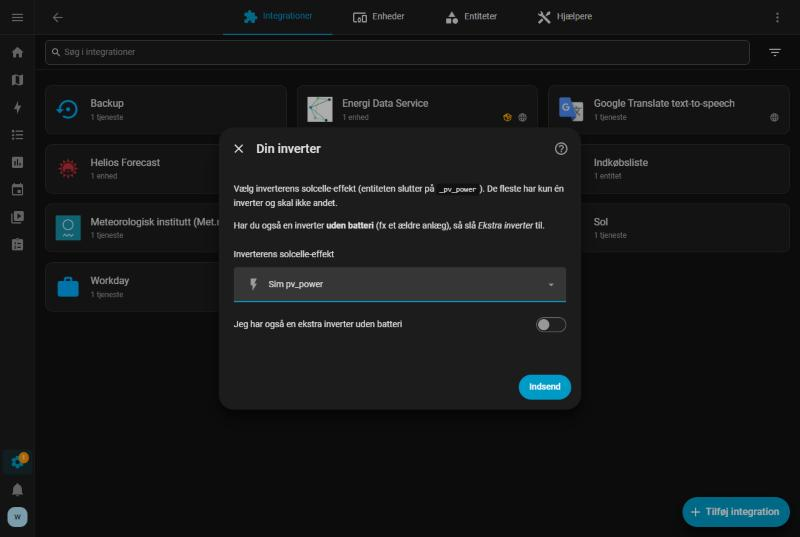

## 4. Tjek af det, Wattlas skal bruge

Wattlas tjekker nu, at EMHASS-app'en kører, at Energi Data Service og Workday findes, at din inverter har de
entiteter, der skal bruges, og at der er en solprognose og et vejr.

**Er alt i orden**, ser det sådan ud. Står der ℹ️-linjer, er det bare til orientering – fx at Wattlas omdøber Workday-
sensoren, så den passer. Tryk *Indsend*.

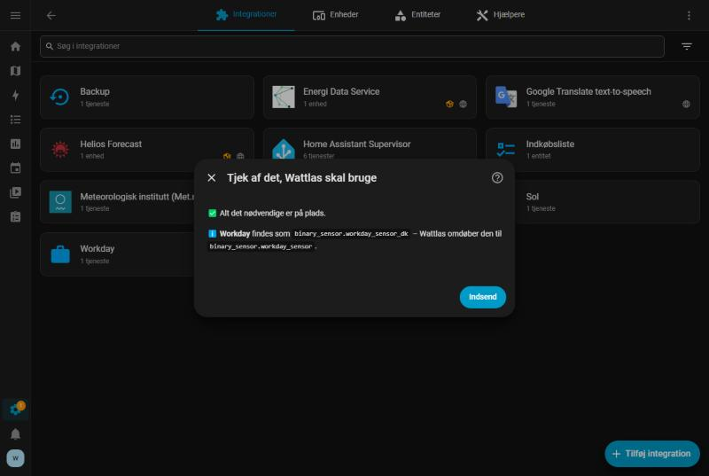

**Mangler der noget**, står det med ❌ og et link, der åbner den rigtige side i din egen Home Assistant. Klar det
(fx tryk *Start* på EMHASS-app'en), kom tilbage, og tryk *Indsend* for at tjekke igen. Du kommer ikke videre, før alt
med ❌ er klaret – så kan intet gå galt.

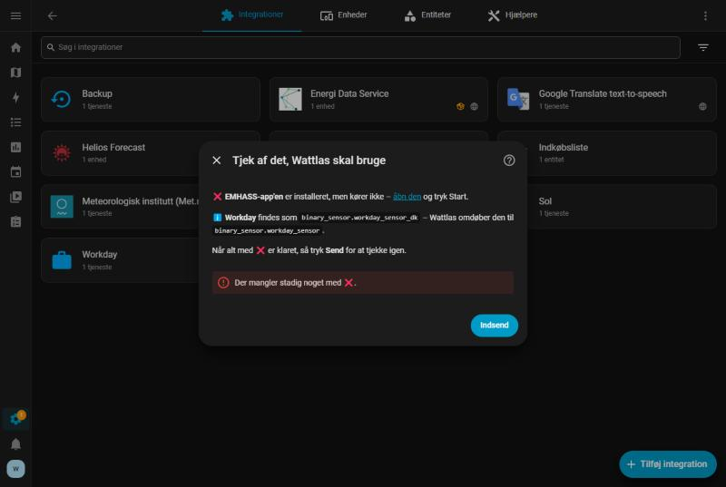

## 5. Forbindelser og prognoser

- **EMHASS-adresse** er udfyldt automatisk, når app'en blev fundet. Lad den stå.
- **EMHASS API-nøgle:** den kode, du valgte under *Før du starter*.
- **Solprognose:** vælg Helios' sensor, der slutter på `_power_now`.
- **Vejr:** vælg dit vejr (fx *Hjem*).
- **Udetemperatur** er valgfri. Uden den bruges vejrets temperatur.

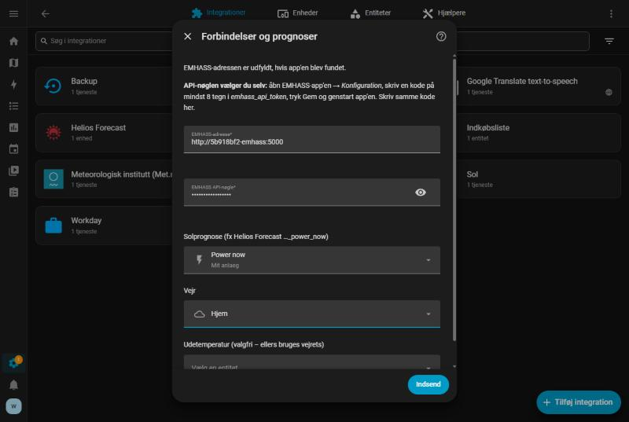

## 6. Batteri og inverter

Tallene står i databladene for inverter og batteri. Under hvert felt står, hvad der menes, og et eksempel.
**Vælg hellere for lavt end for højt** – grænserne er det, der beskytter batteriet, hvis planen tager fejl.

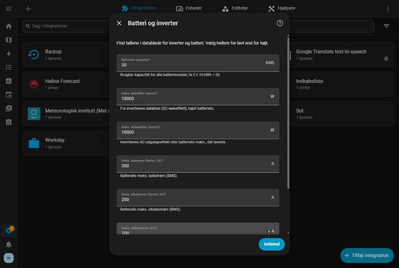

## 7. Elnet og sikringer

Grænserne for strøm pr. fase og samlet import beskytter dine sikringer – også når komfur og varmepumpe kører samtidig
med, at batteriet lader fra nettet. Er du i tvivl, så spørg din elinstallatør.

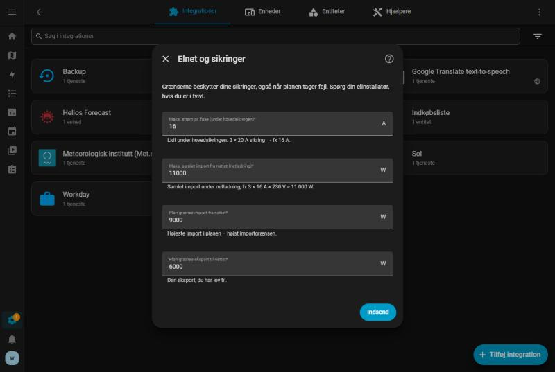

## 8. Priser

Netselskabets tariffer (lav, høj og spids), elafgiften og evt. elselskabets tillæg og gebyrer. De står på din
elregning eller netselskabets hjemmeside. Felter mærket *valgfri* kan stå tomme.

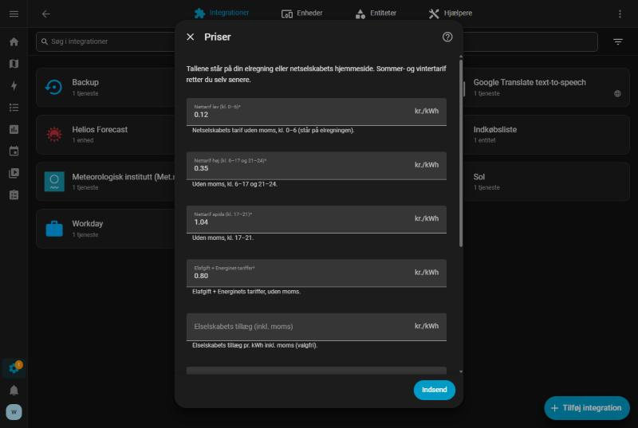

## 9. Færdig – genstart

Tryk *Indsend*. Wattlas lægger automationer, kort og de to dashboards på plads og tjekker Home Assistants
konfiguration. Går noget galt, rulles alt tilbage, og du får at vide hvad.

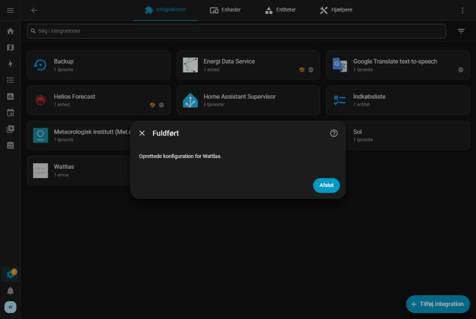

Gå til **Indstillinger**. Øverst står reparationen **Genstart for at fuldføre Wattlas**. Klik på den.

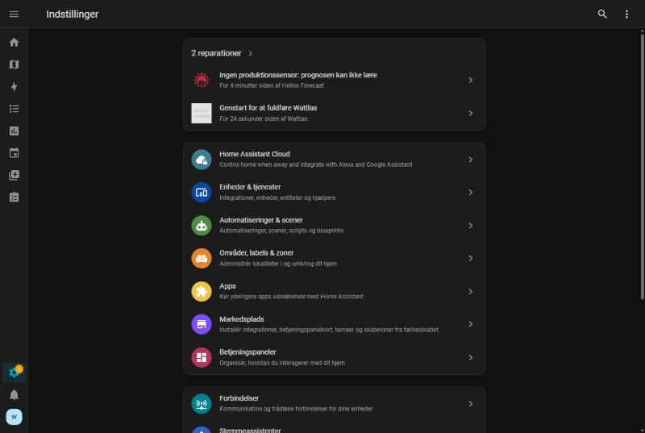

Tryk **Indsend**. Home Assistant genstarter (et par minutter).

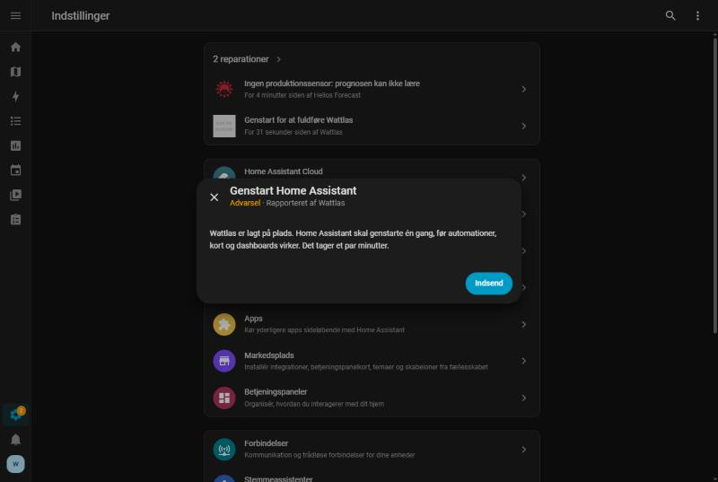

## 10. Wattlas kører

Efter genstarten er der to nye punkter i sidemenuen: **Wattlas** (appen) og **Wattlas Styring**. Dine indstillinger
er overført, og reparationen er væk af sig selv.

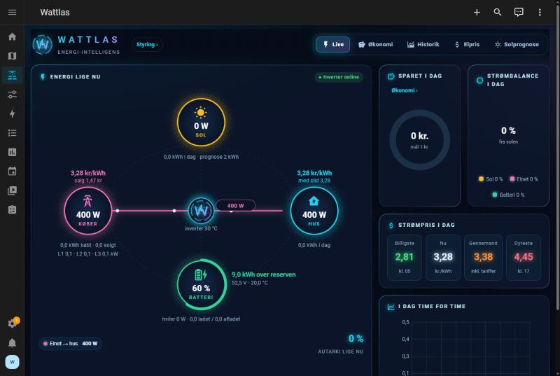

**Styringen er slået fra**, til du selv slår den til. Kig på *Planens logik* et døgn eller to, og slå så
*Wattlas styrer batteriet* til på *Wattlas Styring → Styring* – helst mens du er hjemme.

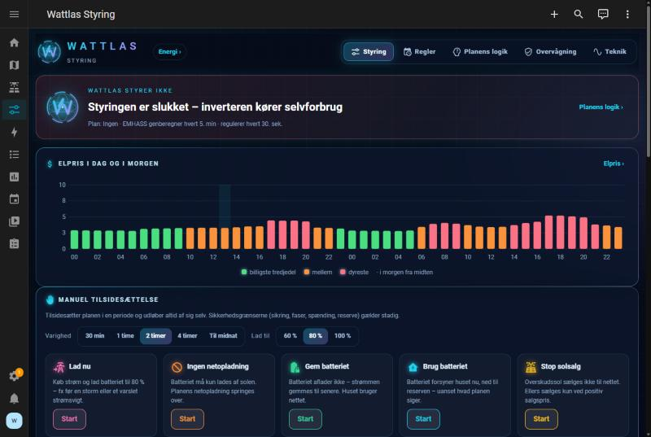

Den første plan kommer inden for 5 minutter. Under *Planens logik* ser du, hvad EMHASS har planlagt, hvad det
forventes at spare, og om de 7 tjek består. De første 3 dage regner Wattlas med husets forbrug lige nu, indtil der er
historik nok til et rigtigt forbrugsmønster. Et enkelt orange tjek er ikke en fejl – læs forklaringen under tjekket.

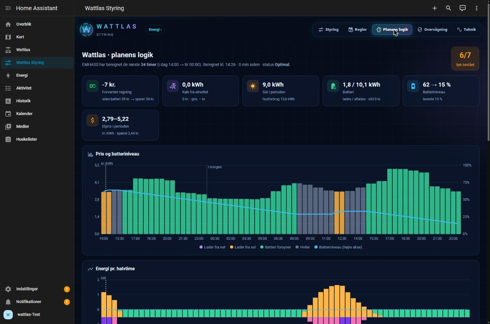

Kun Deye: sæt inverterens 6 tidsprogrammer til **01, 05, 09, 13, 17 og 21**, og slå *Time of use* til (i inverteren
eller Solarman). Wattlas skriver kun effekt og batteriniveau i programmerne, ikke tiderne.

Herfra: se [BRUG.md](BRUG.md) for, hvordan du bruger Wattlas i hverdagen.

---

## Hvis noget går galt

| Du ser | Gør dette |
|---|---|
| *Der findes allerede en batteristyring i …* | Du har en anden EMHASS-styring i forvejen. Fjern den først – to styringer på samme inverter er farligt |
| *configuration.yaml kan ikke rettes automatisk* | Tilføj `packages: !include_dir_named packages` under `homeassistant:` med app'en *File editor*, og prøv igen |
| *Installationen blev ikke gennemført …* | Intet er ændret. Teksten fortæller, hvad Home Assistant brokkede sig over |
| *EMHASS – beregning fejlede* (401) efter start | API-nøglen i Wattlas og i EMHASS-app'en er ikke ens |
| Gul linje øverst i appen: *ikke færdigindstillet* | En indstilling mangler – linjen siger hvilken |

**Fjerne Wattlas:** Slå først **Wattlas styrer** fra, og vent 1 minut (inverteren sættes til selvforbrug). Derefter
Indstillinger → Enheder og tjenester → Wattlas → ⋮ → Slet, og genstart. Filerne flyttes til
`/config/wattlas_backup_<tidspunkt>/` – intet slettes. Tjek bagefter inverterens tidsprogrammer.
